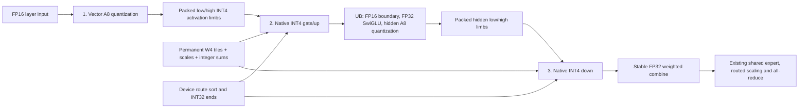

# GLM: a new native integer expert pipeline

This offline candidate changes the quantization contract to fit 310P arithmetic.
It implements the complete routed expert path, its permanent weight preparation,
and a cold-load adapter for every local GLM MoE layer. The existing two-card W2,
three-card W3, and running service are unchanged. No NPU was opened or used during
this work. Compilation, CPU arithmetic checks, and source-derived byte counts
are the available evidence; latency and full-model quality are unqualified.

## What changes

Original block128 FP8 weights are requantized directly to signed W4 with separate
scales for each output channel and each 256 input channels. The export does not
read or further degrade a W2/W3 checkpoint. Scales, integer correction sums, and
packed Cube tiles are saved in their final device layout. Serving copies private
CPU storage to the NPU once, without repacking or transposing weight factors.

Activations use symmetric A8 by default. Two signed INT4 limbs represent each
activation exactly after quantization:

```text
high = floor(q / 16)
low  = q - 16 * high - 8
q    = low + 16 * high + 8

dot(q, w) = dot(low, w) + 16 * dot(high, w) + 8 * sum(w)
```

Both dot products use native INT4 Cube instructions with INT32 accumulation.
The final term uses a permanent weight sum, avoiding extra Cube bias rows.
There is no FP16 weight reconstruction or FP16 expert matmul. A8 still requires
two integer products: this is not a claim that one INT4 instruction replaces all
A8 work. G512 and wider accumulation groups are also implemented in the
projection primitive; the complete UB-fused candidate uses G256 for hidden
activation quantization.

The three-stage native schedule is:



Gate/up results stay in unified buffer through SwiGLU and hidden quantization.
Decode down results and combine also stay in UB. Prefill uses one reusable
128-channel FP16 route slab per core, and each core combines its own output tile
before reusing that slab. Prefill still writes and rereads route values in device
memory; the fused tile protocol reduces retained memory, not total route bytes.
There are three **native** launches, plus PyTorch device routing operations and
the existing outer model operations.

## Work actually removed

- Scale factors are constant across K256, permitting INT32 accumulation before
  a single readback and epilogue. A K4096 projection has 16 G256 epilogues rather
  than 128 block32 scale groups. This eightfold count reduction is not a latency
  measurement or a claim that every old path performed 128 CO1 transfers.
- Numeric FP32 scale `GetValue` calls are absent from the new expert kernels.
  Row scaling uses vector repeat strides rather than scalar numeric factors.
- The default identity-smoothing build omits diagonal uploads, DMA reads, and
  vector division by one. Nonidentity smoothing is supported by a separate
  build, but real activation calibration has not been supplied.
- No full gate/up tensor is written to global memory. Decode also eliminates the
  routed down workspace, and both modes eliminate a separate combine launch.
- The integer-reconstruction variant combines both A8 products and the bias
  in INT32 before conversion. Bounds for G<=4096 keep every intermediate below
  FP32's exact-integer limit. It removes one product-sized conversion and the
  correction conversion per A8 group, without changing the quantizer.
- The v13 address-cache variant prepares original token addresses once per
  projection row block. For K4096/G256, each original route had 16 K loads and
  16 readbacks: one global route read now supplies all 32 uses. Address reads
  from UB remain scalar; the cache is 256 bytes/core, and its extra preparation
  barrier still needs a timing comparison against v11.
- The logical A8 row batch grows from the old kernel's 15 rows to 32, using
  64 physical rows for both limbs. This is a batching capability, not a measured
  improvement in weight traffic or Cube utilization.
- Input quantization is performed once per input token, rather than once per
  expert route. Sorted expert keys skip empty decode experts.
- Top-k eight weights are passed directly, avoiding a zero-fill and copy.

Scalar address/control instructions and conservative `PIPE_ALL` operand-lifetime
fences remain. There is no claim that scalar time is zero. Overlap, operand DMA,
small expert row counts, and routing may still dominate actual device execution.

## Memory analysis

[The ledger](memory-and-work.json) is derived from tensor geometry, not an NPU
allocator measurement. For hidden 4096, intermediate 2048, and top-k eight:

| Incoming tokens | Unfused new MoE scratch | Fully fused scratch |
| --- | ---: | ---: |
| 1 | 0.147 MiB | 0.022 MiB |
| 4 | 0.588 MiB | 0.088 MiB |
| 640 | 94.063 MiB | 24.063 MiB |
| 1280 | 188.125 MiB | 48.125 MiB |
| 2560 | 376.250 MiB | 96.250 MiB |

Scratch belongs to a shared stage arena. Prefill grows with incoming token rows;
it is not allocated for the full context window. Decode shapes 1 through 16 have
separate storage so graph addresses cannot be displaced by prefill. Admission
also reserves a scratch growth peak, route metadata, output, prepared headers,
and a 64 MiB backend allowance. Dense weights, KV/recurrent state, graph pools,
HCCL resources, and pipeline handoffs require separate reservations.

The complete 42-layer, 288-expert overlay contains 150.886 GiB of tensor data.
[All 12,096 shard hashes and native headers passed verification](full-overlay-storage-verification.json);
the original source index still matches its recorded SHA.
The identity build omits 0.277 GiB of stored diagonals from device allocations.
Using r10's measured weights and replacing the inferred old expert storage,
projected TP2/PP3 total weights per rank are 25.532, 29.420, and 30.011 GiB for
stages zero, one, and two. These are projections, not newly loaded measurements.
The explicit per-core TPipe reservations are 191,520 bytes of UB for fused
A8 gate/up, 192,800 bytes for fused decode down, and 160,032 bytes for fused
prefill down. A4 gate/up requests 224,288 bytes. These source-derived amounts
exclude compiler/runtime overhead; actual resource admission remains a device
gate. L1 and L0 reservations are also recorded in the ledger.

An all-W4 two-card model needs a separate capacity plan; retained W2 work remains
useful for that footprint.

A separate optional packed pipeline transport reduces a four-field mHC handoff
from four HCCL collectives to one. It preserves mixed dtypes and independent
receive lifetimes, and transfers ownership of existing warmed groups. It adds
packing copies and temporary storage, so it is not enabled by this loader or the
live service. At 640 rows the packet is 45.049 MiB, with a 90.098 MiB gathered
receive allocation. Its latency benefit must be measured independently.

## Numerical evidence

[The sensitivity study](weight-sensitivity-with-legacy.json) reads nine original
FP8 projections: gate/up/down from layers 3, 14, and 33, expert zero, using 128
uniformly selected output channels. Gaussian and outlier inputs are synthetic;
this is not full-model calibration or a coding-quality evaluation.

| CPU approximation | Mean weight NRMSE | Mean Gaussian projection NRMSE | Mean outlier projection NRMSE |
| --- | ---: | ---: | ---: |
| Existing mixed W3/W4, CPU A4 block32 | 0.2274 | 0.2491 | 0.2878 |
| New W4 G256, A8, clipping 0.9 | 0.1117 | 0.1112 | 0.1169 |

The legacy CPU approximation does not reproduce every NPU rounding boundary.
These results support testing the new contract; they do not qualify GLM reasoning
or coding quality. A4's outlier error was substantially larger, so A8 remains the
default. Clipping 0.9 is a candidate choice, not a calibrated optimum.

The separate [reciprocal variant](reciprocal-sensitivity.json) replaces a
256-lane normalization division with an eight-lane reciprocal and broadcast
multiply. Tiny FP16 synthetic values changed approximately 0.15% of activation
codes; each changed by at most one. It is opt-in and must pass its own quality
gate.

## Available validation

- CPU exact integer references cover A4/A8 and supported accumulation groups.
- Complete routed-MoE simulations cover repeated experts, peer routes, zero
  weights, stable combine order, native factor layout, shared arena lifetimes,
  admission failures, and fused three-launch paths.
- CPU interpreters exercise the production vector epilogue and prefill tile
  ownership/control code, including 640 rows and hidden width 4096. The protocol
  test stubs the dot product; it does not emulate Ascend instruction execution.
- Real safetensors tests cover original FP8 blocks, permanent native storage,
  SHA failures, interrupted-export resume, and manifest geometry admission.
- Loader tests cover all three pipeline partitions and reject a mismatched
  indexer manifest before native expert allocation.
- **127 CPU checks pass**; the production integer reconstruction helper is
  checked against the previous floating order and an INT64 oracle, with guard
  bytes and all supported accumulation groups.
- The opt-in nightly NPU gate is present but was skipped offline.
- Both builds compile for `dav-2002` using CANN 9.1 and the serving Torch ABI.
  [v8 provenance](v8-tiled-prefill/provenance.json) records the direct-division
  build; [v9 provenance](v9-reciprocal/provenance.json) records the reciprocal
  build. [v11 provenance](v11-integer-products/provenance.json) and
  [v12 provenance](v12-integer-reciprocal/provenance.json) additionally record
  exact integer reconstruction, with direct and reciprocal division respectively.
  [v13 provenance](v13-route-address-cache/provenance.json) additionally records
  the route-address cache, with [real-bank CPU admission](operator-admission-v13.json).
  Six kernels plus their bridge are hashed in each bundle. Early v4's
  missing row macro was corrected; only the final build provenance is relevant.
- [Real-bank CPU admission](operator-admission-v11.json) passes for the final v11
  bundle and a four-expert subset, without loading its native shared library.

The final [validation record](validation.json) separates the completed offline
gates from pending hardware work.

See [the runbook](RUNBOOK.md) for artifact locations, cold-load options, and the
required hardware gates. Nothing in this report is a measured new tok/s result.
