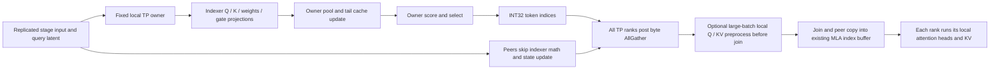

# GLM rank ownership: offline candidate

The ordered [next experiment queue](NEXT.md) records remaining operand,
router, prefill-combine, and indexer-head opportunities with memory and validation
gates.

The sparse indexer is fully replicated within each TP group. The candidate
executes it on one fixed local TP rank and shares its INT32 token indices with
the group's attention shards. Both `glm_native_int4` and
`glm_channel_scale_candidate` loaders accept this opt-in. No weight quantization,
rounding, routing, selection arithmetic, or live service was changed.

This removes duplicate executions, **not the owner's critical-path work**.
Peers need the indices and still join a collective. There is no measured speedup
yet. On separate chips without resource contention, a synchronous owner plus
transfer can be slower than parallel duplicated computation. Promotion requires
wall-time evidence; reducing total operations alone is insufficient.

A second optional mode posts the result transfer asynchronously for batches
larger than eight rows, lets every rank run its local MLA Q/K preprocessing and
KV insertion, then joins and publishes the owner indices before attention reads
them. This adds useful work to the peer's wait interval. Small decode graphs keep
the synchronous transfer. The CPU ordering gate passes; actual HCCL overlap and
latency gains remain unmeasured.

## Source-backed ownership map

| Operation | Current ownership | Consumers and action |
|---|---|---|
| Decoder layers | Local PP stage only | `make_layers` and `_active_layers` already exclude other stages. |
| Input embedding | First PP stage, vocab-sharded TP | Both local shards are needed. |
| LM head | Last PP stage, vocab-sharded TP | Both local shards are needed; earlier stages return before logits. |
| Sparse indexer | Fully repeated on every TP rank of its stage | Replicated inputs and weights; all attention shards need identical final indices. Implemented fixed-owner candidate. |
| KDA recurrence and attention heads | Head-sharded TP | Local state and heads differ; retain each rank's work. |
| Routed experts | Expert partitions within TP | Only locally owned experts contribute; retain local math and final reduction. |
| Shared expert | TP partial result | Keep every partial; reducing only routed experts loses shared contributions. |
| Router gate and top-k | Repeated within each TP group | Further candidate: one owner and a small IDs/weights transfer, while every rank keeps local experts. Not changed here. |
| mHC residual transforms | Replicated within TP | Inputs are needed by both shards; ownership would transfer large residuals or require a different residual architecture. |
| KDA `f_a`/`g_a` | Two replicated shards inside an otherwise TP-sharded merged projection | Small replicas already share one GEMM launch. Splitting them introduces communication; do not remove the entire projection. |
| Input activation quantization | Repeated within TP in the new integer candidate | Shared input, local expert consumers. Compare the quantization cost against a transfer before assigning an owner. |
| Sampling and logit postprocessing | Final-stage TP ranks in the normal PP path | Upstream logits use AllGather and the runner invokes sampling. Final request output has fewer consumers; an owner sampler needs RNG, logprob, grammar, and output-protocol work. Not changed here. |

Evidence:
[model and PP boundaries](../../../vllm_ascend/models/glm5next/model.py),
[replicated indexer projections](../../../vllm_ascend/models/glm5next/attention.py),
[indexer cache writes and selection](../../../vllm_ascend/models/glm5next/sparse_attn_indexer_kpool.py),
[local routed/shared reduction](../../../vllm_ascend/models/glm5next_w2/moe.py),
[KDA projection shards](../../../vllm_ascend/models/glm5next/kda.py),
[runner logits and sampling](../../../vllm_ascend/worker/model_runner_v1.py).
The active [310P frontend](../../../vllm_ascend/_310p/attention/mla_v1_310.py)
invokes the indexer before `mla_preprocess_decode` / `mla_preprocess_prefill`.
The optional overlap mode wraps that loaded frontend instance, joining at its
return before the attention cores read the shared selection buffer. The upstream
CUDA-style wrapper has a different ordering and is not the overlap target.

## Candidate dataflow

The owner is a **local group rank**, not global rank zero. TP2/PP3 gets three
independent owners. TP4/PP1 gets one. The production candidate reuses existing TP
device groups; it creates no new process groups. Rank membership and collective
ordering still apply to every peer.

AllGather is used because the existing 310P pipeline work qualified that
collective family. This new TP indexer transfer and its asymmetric graphs still
need their own HCCL gate. Every rank contributes one payload; only the owner's
slice is meaningful. This is a byte-preserving result distribution, not a
calculated reduction or an assertion that AllGather is the fastest distribution.

The INT32 buffer already retained by MLA keeps its address. Every stage shares
one preallocated receive slab across its sequential indexers. Returned index
buffers are the existing sequential scratch, not independently owned outputs.
No runtime tensor scalar read, device-to-host read, host upload, or scratch
allocation is added to the forward.

With overlap enabled, a pending transfer owns stage scratch until the frontend
joins it. Starting another indexer before that join is rejected. Admission
requires exactly one supported 310P MLA frontend per owned indexer and at most
eight decode sequences. There is one collective per sparse layer in both modes;
the overlap option adds no second transfer or extra receive slab.

## Static counts and memory

The original local config declares 45 layers, including 11 sparse layers,
hidden size 4096, query latent 1536, and 32 indexer heads of dimension 128.
Each indexer has 7,471,104 projection weight elements across Q, merged K/head
weights, and compression gate. The selection width is 2176 INT32 columns,
including the incomplete pool tail and 128-column padding.

| Target-only profile, 640 tokens | Original / owned indexer executions per model forward | Receive slab per rank | Avoided projection operations |
|---|---|---|---|
| TP2 / PP3, three cards | 22 / 11 | 10.625 MiB | 105.193 billion |
| TP4 / PP1, two cards | 44 / 11 | 21.25 MiB | 315.579 billion |

Counts use multiply-plus-add as two operations and exclude score/compression
work. Sparse layer counts by stage are 3, 4, 4 for TP2/PP3. Memory is per stage
rank, **not per sparse layer**. Owner result bytes per sparse layer are 5.3125 MiB
at 640 rows. Decode payloads are 8704 bytes per row. AllGather communication volume
and latency depend on the collective implementation; result bytes are not a
measurement of link traffic.

Peer weights and auxiliary indexer cache allocations remain registered. Their
contents are not consumed by the owned indexer. Local MLA KV remains active on
every rank. Reclaiming peer indexer storage requires a separate cache-planning
change; this candidate claims no such memory saving.

Calculated counts are in [three-card-640.json](three-card-640.json) and
[two-card-640.json](two-card-640.json), generated by
[rank_work_audit.py](../../../tools/glm_perf/rank_work_audit.py).

## Constraints and qualification

- Cold-load only, fixed owner throughout the session. Ownership cannot be
  rebound. Peer indexer state is stale, so returning to replicated execution
  requires a fresh load, not a hot rollback.
- DP1, no sequence/context-parallel token partition, no MTP, no KV-transfer connector.
  The two-card W2 and three-card W3 checkpoints remain intact; the target-only
  restriction concerns this candidate, not those checkpoint formats.
- Eager is allowed. Graph mode requires `FULL_DECODE_ONLY`, explicit capture
  sizes within 1..8, and an already prepared capture-safe selector. The installer
  refuses an owner-only eager capture break and does not change selection mode.
- Ownership and receive-buffer byte reservation are admitted before weight I/O.
  Dense weights, KV, HCCL resources, PP buffers, and graph pools still need their
  own memory reservation. No maximum-context receive allocation is introduced.
- Only TP2 and TP4 production configurations are admitted. Generic byte transport
  does not solve GLM's head divisibility or establish TP6 model support.

CPU checks cover group-local ownership, ordered/reordered members, six workers,
stage isolation, zero peer indexer executions, persistent owner state, changed
inputs, exact INT32 values above FP32's exact integer range, padding sentinels,
stable scratch addresses, memory rejection, and loader ordering.

Real Gloo process gates passed on six CPU processes (TP2 groups representing
PP3) and four CPU processes (TP4), with nonzero owners and rows 1, 4, 37, 640.
Receipts are [gloo-tp2-pp3](gloo-tp2-pp3) and [gloo-tp4](gloo-tp4).
These are synthetic transport tests, **not NPU or real-indexer validation**.
The same process gates run with deferred completion in
[gloo-overlap-tp2-pp3](gloo-overlap-tp2-pp3) and [gloo-overlap-tp4](gloo-overlap-tp4).

The combined ownership, loader, integer-pipeline, and transport CPU gate passes
188 tests. Both nightly device gates skip during ordinary offline collection.
All manual repository hooks pass for the owned files. `bash format.sh ci` was
also run across the full repository; it fails on existing unrelated formatting,
spelling, and forbidden `re` imports. Its automatic changes to 144 unrelated
files were restored in the isolated worktree. Logs and source hashes are listed
in [validation.json](validation.json).

Required next gates are HCCL changed-input graphs, real-indexer state/selection
parity, cached and cold model requests, sampled/logprob and coding parity, actual
peak memory, and matched cold-prefill/decode latency. Test the existing native
checkpoint first so quantization is held fixed. See [RUNBOOK.md](RUNBOOK.md).
