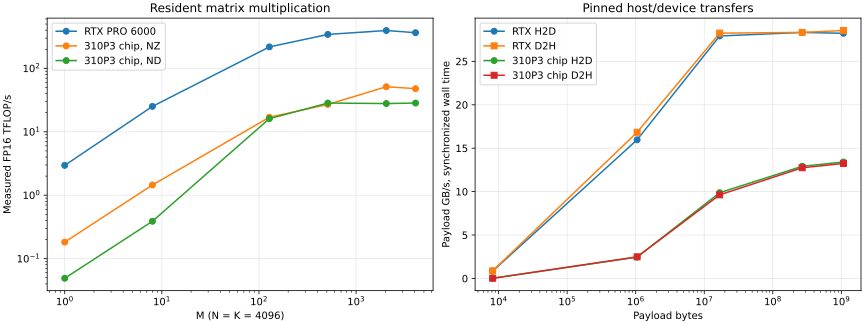

# RTX PRO 6000 and Ascend 310P3 raw math study

Hardware measurements from October 11, 2026 EDT / October 12 UTC. The GLM
experiment was stopped before benchmarking. The other Ascend card's Qwen workers
remained running; their process IDs and allocations are preserved in the hardware
snapshots. The assigned card and RTX were released after the experiments.

**The RTX was faster across the successfully matched resident math cases in this
study.** Ascend benefited from batching, INT8, and appropriate weight layout, but
this hardware/software combination supplied no measured compute reason to put
Ascend on a latency-sensitive RTX operation's critical path. Independent work on
the second architecture remains a way to add capacity and throughput. These are
measurements of the installed stacks, with their API and submission overhead.

## Headline measurements

Resident 8192-square GEMM, queued device-event median, 15 samples. Integer multiply
and add each count as one operation; FP16 uses the same count for floating math.

| Configuration | FP16 TFLOP/s | INT8 TOP/s |
| --- | ---: | ---: |
| RTX PRO 6000, cuBLAS | 409.84 | 750.31 |
| One Ascend 310P3 chip, NZ weights | 27.34 | 56.16 |
| Both chips on one Ascend card, independent jobs | 48.66 | 108.17 |

The both-chip result uses a shared coordinator wall interval and includes
submission, synchronization, barrier/IPC coordination, and receipt of both
workers' completions. GPU and single-chip rows use device events. Those timing
contracts differ; the full receipts contain wall and device samples for each
worker. The both-chip experiment measures two independent jobs, not one sharded
matrix multiplication. At 4096-square, the combined Ascend results were **84.54
TFLOP/s FP16 and 153.46 TOP/s INT8**.

For an M=1, N=K=4096 GEMM, RTX FP16 took **11.349 µs** versus **183.950 µs** on
one Ascend chip with NZ weights. INT8 took **13.290 µs** versus **78.964 µs**.
For M=128 with the same N/K, FP16 throughput rose to **217.89 versus 16.96
TFLOP/s**. Batch size materially changes the useful throughput of both devices.



Download the [PNG figure](receipts/comparison.png), [all comparison tables](receipts/comparisons.md),
or [CSV measurements](receipts/measurements.csv). CSV includes both timing modes,
both Ascend layouts, pageable/pinned copies, rejected cases, and an explicit column
for the reduced-input-precision diagnostic. Individual JSON receipts retain every
timing sample and numerical gate.

## Precision findings

CUDA's strict FP32 8192-square GEMM reached **64.67 TFLOP/s**. It used
`CUBLAS_COMPUTE_32F_PEDANTIC`; the maximum sampled absolute error across all nine
FP32 matrix cases was **1.848e-6** against CPU FP64 dot products rounded to FP32.
CUDA FP16, BF16, and INT8 had zero sampled error after rounding the reference to
their specified output dtype. These are sampled numerical checks, not exhaustive
proofs over every matrix element.

Ascend's FP32 tensor dtype did **not** qualify strict FP32 GEMM. All 18 ND/NZ matrix
cases failed the strict reference even with `torch.npu.matmul.allow_hf32=False`.
A separate diagnostic repeated those shapes against FP16-rounded inputs with
FP32 output: **18/18 passed**, with maximum sampled error **3.577e-7**. Against
the original FP32 reference, its maximum sampled absolute error was **3.093e-4**
and maximum sampled relative L2 error **4.986e-4**. The results are consistent
with FP16-input computation and are excluded from the strict FP32 speed comparison.

This behavior is consistent with Huawei's CANN documentation: for Atlas inference
products, FP32 inputs with `cubeMathType=1` are converted to FP16, and preserving
FP32 through `cubeMathType=0` is unsupported. This is a statement about that GEMM
API path; the FP32 vector operations below passed their reference checks.
[Huawei aclnnMm documentation](https://www.hiascend.com/document/detail/en/CANNCommunityEdition/910/API/aolapi/context/ops-nn/aclnnMm.md).

The Ascend BF16 GEMM capability probe was rejected: the runtime explicitly listed
FP32 and FP16 as its supported floating input types. CUDA BF16 passed all nine
matrix cases and reached **436.96 TFLOP/s** at 8192-square. Ascend INT8 with ND
weights was rejected for all nine shapes; NZ weights passed all nine. The INT8
comparison uses already quantized inputs, unit scales, and FP16 output. CUDA's
INT32-to-FP16 conversion is included in its timing. Activation quantization and
model weight reconstruction are outside these resident measurements.

## Weight layout, vector math, and transfers

For Ascend FP16 M=1, N=K=4096, preformatting the weights as NZ improved resident
latency from the ND path. At 4096-square, NZ also improved throughput materially.
ND and NZ can be close at other batch sizes. Both curves are plotted; format
conversion itself is outside these timings. A format's advantage should be
evaluated for the intended shape and reuse pattern.

The tested vector operations were FP32 add, exp, stable softmax, and RMSNorm.
All **32 device/operation/shape combinations passed**. RTX was faster for every
matched vector case. For 2048×4096 rows, softmax measured **21.984 µs on RTX versus
442.825 µs on Ascend**; RMSNorm measured **16.048 versus 387.988 µs**. CUDA used
the standalone fused kernels in this repo, while Ascend used torch_npu/CANN
operators. Those results include implementation differences.

Copy measurements use single-call synchronized wall time below. GB/s is decimal
payload bandwidth. D2D read-plus-write traffic is twice the payload rate and is
exported separately in CSV.

| Copy path | Size | RTX wall time | Ascend wall time | RTX GB/s | Ascend GB/s |
| --- | --- | ---: | ---: | ---: | ---: |
| D2D | 1 GiB | 1.474 ms | 11.064 ms | 728.36 | 97.05 |
| Pinned host → device | 1 GiB | 38.034 ms | 80.065 ms | 28.23 | 13.41 |
| Pinned device → host | 1 GiB | 37.605 ms | 81.076 ms | 28.55 | 13.24 |
| Pinned host → device | 8 KiB | 9.669 µs | 393.368 µs | 0.847 | 0.021 |
| Pinned device → host | 8 KiB | 9.338 µs | 383.850 µs | 0.877 | 0.021 |

All **50 copy cases passed full byte comparisons**, including changed inputs.
The transfer suites ran sequentially to avoid competition between the benchmark
processes for host bandwidth. GPU copy calls use the CUDA runtime; Ascend calls
use torch_npu. These figures include those APIs' synchronization and dispatch.
They explain why small host-staged transfers need careful accounting; an
integrated GPU/NPU handoff, socket IPC, and a full model were not timed here.

## Hardware and software

| Item | Installed configuration |
| --- | --- |
| GPU | NVIDIA RTX PRO 6000 Blackwell Workstation Edition, SM120 |
| GPU reported memory | 97,887 MiB, approximately 95.6 GiB |
| Ascend card under test | Card 16409, two Ascend 310P3 chips, physical devices 2,3 |
| Ascend reported memory | 47,302 MiB and 46,717 MiB, approximately 46.2/45.6 GiB |
| Other Ascend card | Physical 0,1; Qwen workers 1474732 and 1474733 retained |
| CPU | AMD Ryzen Threadripper 3970X, 32 cores / 64 threads |
| System memory | Approximately 247 GiB reported by the OS |
| NVIDIA driver | 615.71.09 |
| CUDA compiler | 13.4.92 |
| cuBLAS | 13.8.0.4 |
| CANN compiler and OPP | 9.1.0 |
| Ascend runtime | PyTorch 2.13.0+cpu; torch_npu 2.13.0.rc1; Python 3.12.13 |
| CUDA input/reference runtime | PyTorch 2.13.0+cpu; Python 3.14 |

See [start snapshot](hardware-start.json), [end snapshot](hardware-end.json), and
the [GLM shutdown receipt](receipts/shutdown-complete.json). No clock, power-limit,
or ECC settings were changed for this study. The GPU's configured power limit was
600 W and its reported ECC mode was disabled. Snapshots also preserve unavailable
diagnostic commands with their return codes. This host was not reserved in its
entirety; the other card's Qwen workload remained present.

## Method and limits

- GEMM computes `X[M,K] @ W[N,K].T`; the sweep includes small output, vector,
  batched, 4096-square, and 8192-square shapes in each tested precision.
- Shared deterministic CPU seeds generate matched inputs. Floating GEMM inputs
  use normally distributed values scaled by 1/16; INT8 uses values from -2 to 2
  to avoid output overflow. These are synthetic workloads.
- Three warmups and 15 samples are retained for single-call and queued modes.
  Device events include stream idle gaps caused by submission. Wall times include
  enqueue, events, and synchronization. CUDA queues through C++; Ascend through
  Python/torch_npu. These are runnable-stack measurements rather than instruction
  peak measurements or a comparison of equally optimized kernels.
- Inputs and weights are resident before compute timing. Initialization, uploads,
  layout conversion, reference computation, and result readback are excluded.
  Ascend quantized GEMM and RMSNorm return vendor-allocated outputs; CUDA reuses
  outputs. Copies include the requested transfer.
- Repeated operations reuse buffers and may benefit from caches. The large
  buffer cases provide additional evidence about memory traffic. Small-buffer
  rates should not be interpreted as streaming external-memory bandwidth.
- Initial, changed-input, and final numerical checks reject stale output. GEMM
  samples first/middle/last rows and selected columns against CPU FP64. Row math
  checks every column of sampled rows. Elementwise math checks up to 1024 evenly
  spaced elements. All arithmetic outputs receive full finite-value checks;
  copies compare all bytes.
- Source and CUDA library hashes are recorded in each applicable receipt.
  The [executed benchmark source](qualified-source/benchmark.py.txt) preserves
  the qualified hash; the repository entry point subsequently received only a
  main-function docstring. Its arithmetic and timing code is unchanged.
  The independent-job card experiment validates both chips before and after
  concurrent timing. It measures aggregate jobs completed in one wall interval.
- One narrow FP16/NZ timing sweep was rejected for a nonpositive event reading.
  It remains visible in the primary receipt and has no assigned speed. A separate
  [repeated matrix sweep](receipts/npu-matrix-repeat.json) qualified all 18 FP16
  layout/shape combinations and all nine NZ INT8 cases. The narrow NZ case passed
  with a queued median of 16.429 µs. The repeated sweep leaves the primary results
  intact. Unsupported and inaccurate cases likewise remain visible.

## Reproduce and inspect

The [benchmark README](../../tools/raw_math/README.md) contains build and run
commands, precision contracts, the host's device-ownership guard, and export
instructions. CUDA uses a standalone cuBLAS library, so a CUDA-enabled PyTorch
installation is unnecessary. Run each backend's suites sequentially, and run
the two transfer suites separately.

The receipts directory contains exact command arguments for the executed runs.
The remote run used a copy of `tools/raw_math` as the top-level `raw_math` package;
repository commands use `tools.raw_math`. Preserved CANN environment paths came
from the qualified host installation. Runtime environment contents are excluded
from the published artifacts.

```bash
python -m tools.raw_math.report artifacts/raw-math-20261011/receipts --plots
pytest -q --confcutdir=tests/ut/raw_math tests/ut/raw_math
```

**Offline validation:** 33 CPU regression tests passed, covering numerical
contracts, stale outputs, precision diagnostics, timing/rate units, bounds, copy
integrity, report failure handling, and large-vector sampling. Changed-file lint
and formatting checks passed. Hardware qualification is documented above and
in the complete JSON receipts. Repository-wide formatting has existing baseline
failures; its [isolated-worktree receipt](repository-format-check.json) is included
with the study. Seven baseline hooks failed, with no changes to this study's files.
