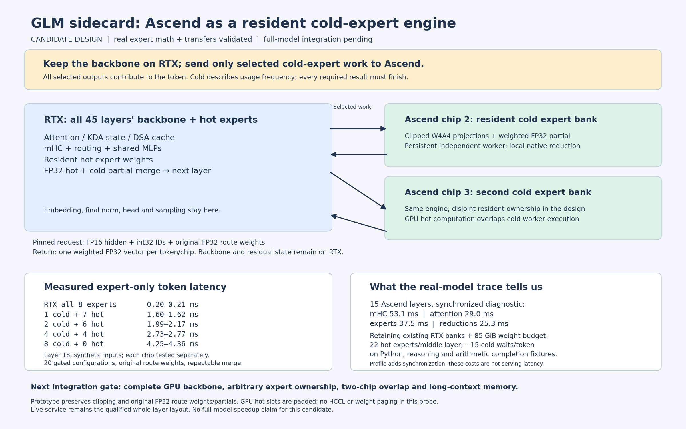

# GLM sidecard cold-expert study — October 12, 2026

The measured component prototype supports using Ascend as a resident expert
engine while RTX owns attention, mHC, routing, shared MLPs and hot experts.
Moving these operations off Ascend addresses substantial work in the current
middle stage. Full-model integration and its serving performance remain pending.



## Real-model attribution

A private diagnostic runtime profiled all 15 Ascend middle layers on physical
devices 2 and 3. CUDA placement, kernels, graph settings, checkpoint and
arithmetic policy matched the qualified V18 service. The diagnostic explicitly
synchronized every component; these times include synchronization and collective
waits. They cannot be subtracted directly from the normal 101 ms stage latency.

| Component across 15 layers | Decode, matched 2K fixture | Prefill, 32-row chunks |
| --- | ---: | ---: |
| Deferred and attention mHC post; attention and FFN mHC pre | 53.14 ms | 88.82 ms |
| Attention | 28.98 ms | 153.52 ms |
| Attention SUM and combined MLP SUM | 25.26 ms | 51.63 ms |
| Router | 4.62 ms | 28.56 ms |
| Native routed experts | 37.48 ms | 230.39 ms |
| Shared MLP | 5.91 ms | 6.23 ms |

Values are medians of each packet's summed leader-rank component times;
rank-one traces are also retained. Category medians need not sum to the median
complete stage time. `component-summary.json` retains the other workload costs.

The profile observed 383 packets and 2,421 token rows per rank. It covered the
fixed teacher-forced numerical gate, the existing 2,048/64 completion fixture,
and three short Python, distributed-database and arithmetic completion prompts.
All 64 complete prefix/middle/vocabulary traces in the teacher-forced gate
matched the unprofiled V18 reference bitwise. Both ranks selected identical
expert IDs and original FP32 route weights throughout the trace.

The three short prompts are raw completion inputs without the chat template.
Their continuations are routing fixtures, not instruction-following or accuracy
qualification. Four workload decode evaluations each contain 63 token steps.

## Cold experts remain a decode dependency

The model's main payload is 131.92 GiB; all non-expert text weights use 16.62 GiB.
Retaining every current GPU expert bank and moving the remaining backbone to
GPU requires 81.10 GiB before adding hot experts from the middle layers.
A provisional **85 GiB weight allowance** leaves room for **22 W4 experts per
middle layer** with equal allocation, giving 84.98 GiB of GPU weight payload.
Cache, workspace, graph allocation, preparation peaks and reserve still need
hardware admission for the candidate. This is not a qualified memory budget.

Hot sets below use only the corresponding prompt's prefill observations;
decode is held out. Original top-eight selections and route weights stay intact.
Zero-weight routes are inert; every positive-weight selected cold expert counts.

| Completion fixture | Cold route fraction | Layers waiting for cold work per token | Tokens touching cold work |
| --- | ---: | ---: | ---: |
| Matched repetitive 2K | 26.24% | 12.70 / 15 | 100% |
| Python | 62.41% | 15.00 / 15 | 100% |
| Distributed database | 60.44% | 14.95 / 15 | 100% |
| Arithmetic | 64.22% | 14.97 / 15 | 100% |

`routing-study.json` also retains larger resident sets and a separately labeled
decode-hindsight bound. For example, 64 hot experts/layer leaves about five
waiting layers for the repetitive fixture, but about 14.5–14.8 for the other
three. That allocation exceeds the stated weight allowance while retaining
the existing GPU banks. Rebalancing ownership across all 42 MoE layers needs
additional routing observations; this study covers the 15 middle layers only.

Cold denotes frequency, not optional computation. The candidate needs a fast
expert path even when essentially every middle layer sends work to Ascend.

## Real-weight expert-only overlap probe

The bounded prototype keeps layer 18's first eight W4 experts resident on both
architectures. A private independent Ascend worker receives FP16 activations,
int32 IDs and the original FP32 route weights through persistent pinned host
buffers. It returns a locally weighted FP32 partial. RTX hot-expert work starts
after dispatch and overlaps the native cold computation; RTX merges both
partials in FP32. The probe executes no attention, mHC, HCCL or weight paging.

Each assigned NPU chip was tested separately against the same weights and
synthetic activations. This does not validate concurrent two-chip dispatch.

| Selected cold experts | Selected hot experts | Single-token complete expert path | Native cold computation only |
| --- | ---: | ---: | ---: |
| 0 | 8 | 0.20–0.21 ms | None |
| 1 | 7 | 1.60–1.62 ms | 1.21–1.27 ms |
| 2 | 6 | 1.99–2.17 ms | 1.63–1.67 ms |
| 4 | 4 | 2.73–2.77 ms | 2.37–2.39 ms |
| 8 | 0 | 4.25–4.36 ms | 3.87–3.93 ms |

Ranges span the two chips' medians. Each case uses three warmups and twelve
measured iterations. The request carries 8,256 bytes/token; the reply carries
16,384 bytes/token, plus bounded headers/timing. Timed wall latency includes
CUDA readback, socket dispatch, NPU upload/native computation/download, CUDA
reply upload and the FP32 merge. Native timing includes deterministic padding,
route preparation, projection, activation quantization and local reduction.

Twenty configurations cover one and 32 input rows with zero, one, two, four
or eight cold slots. Every merged result passed the independent authenticated
CPU quantizer reference at `rtol=0.002, atol=0.002`. Maximum observed absolute
error was 0.00000763; all warmup and measured merges repeated bitwise. Fixtures
exercised checkpoint SwiGLU clipping. Route weights are split without
renormalization, and positive-weight cold routes are never omitted.

GPU hot work still executes padded eight-slot projections when any hot slot
exists. Ascend retains the qualified fixed-slot reducer with zero-weight
padding to 17 rows for decode. These are measured prototype limitations.
The 32-row results and all samples remain in the qualified probe receipts.

## Service restoration and delivery

The supervisor stopped only the recorded V18 GLM parent and its owned actors,
then restored the exact qualified source into V20 with a fresh HCCL port.
Physical Ascend devices 0 and 1 were outside every diagnostic's visibility.
No driver resets, clock changes, ECC changes or global cache operations ran.

The service remains at `http://192.168.53.187:8000/v1`, model `glm-sidecard`,
configured context 65,536. Restored startup passed the original TP, expert
repeat, full-model repeat and pipeline gates. A completed zero-cache 2,048/64
API request measured **7.68 decode tok/s**, with **30.03 s** to first text.
Two chat arithmetic smoke requests returned the expected answers. This is the
existing whole-layer architecture; the cold-expert candidate has no measured
full-model token rate or newly qualified long-context limit.

Reproduction uses private runtime specifications whose environment files stay
on the host. Source snapshots and public receipts contain paths and hashes,
not environment contents. Set `stage_profile: true` and keep NPU decode graphs
disabled only in a disposable diagnostic snapshot, then run:

```bash
python -m tools.sidecard.layer_profile_run \
  --config /path/to/diagnostic/runtime.json \
  --reference /path/to/qualified/decode-repeat-gate.json

python -m tools.sidecard.cold_expert_probe \
  --config /path/to/qualified/runtime.json \
  --device 0 --output /path/to/new/cold-probe.json
```

Use the isolated CUDA Python environment with its qualified CUDA settings;
the probe reads the private NPU environment and starts only its own worker.
`--device 1` selects physical chip 3 through the same assigned visibility.
The caller must arrange service restoration before starting full-model
diagnostics; the profiling driver closes its own actors but does not launch
the serving API.

Retained evidence:

- `profile-run.json`, `rank-route-parity.json`, and compressed per-rank traces:
  real-model routing and complete boundary/logit parity. The compact run
  manifest hashes generated text; `profile-run.raw.json.gz` preserves the exact
  executed manifest and unedited model continuations, including model typos.
- `profile-source-sha256.json`, `cold-probe-source-sha256.json`:
  hashes of the two executed snapshots.
- `cold-probe-rank0-qualified.json`, `cold-probe-rank1-qualified.json`:
  qualified gates and timings on both assigned chips.
- `cold-probe-qualified-source.py.txt`: the exact executed probe. The delivery
  source adds an explanatory function docstring for lint; its executable AST
  matches the qualified source after excluding docstrings.
- `cold-probe-rank0.json`, `cold-probe-rank1.json` and
  `cold-probe-executed-source.py.txt`: earlier pilot results/source.
- Restored runtime, decode, arithmetic and deployment receipts: live service
  ownership and completed API evidence.
- `architecture.png`: candidate placement, dependencies and measured limits.

The next full-model gate must load the complete CUDA backbone, authenticate
arbitrary hot/cold expert ownership, overlap independent two-chip replies,
preserve deterministic partial combination and admit realistic long-context
memory. Component measurements alone do not establish that serving speedup.
