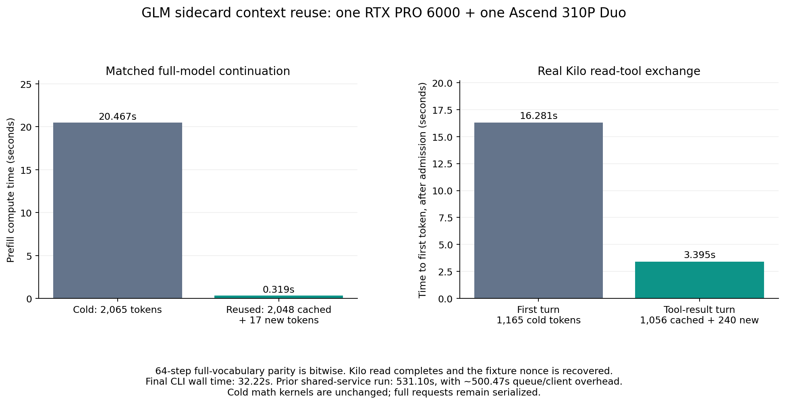

# Kilo Code entry for the GLM DMA sidecard service

`~/.config/kilo/kilo.jsonc` now includes `vllm-sidecard/glm-sidecard` with
function-call support. Existing providers and the selected Qwen default are
preserved. Timestamped backups precede configuration edits.

Use the compact sidecard Code agent:

```bash
kilo "$PWD" --agent glm-sidecard-code --model vllm-sidecard/glm-sidecard
```

The normal Code agent also supports this endpoint:

```bash
kilo "$PWD" --model vllm-sidecard/glm-sidecard
```

For CLI `run` requests, pass `--dir "$PWD"` explicitly. A local provider probe
confirmed that implicit selection can use a different project configuration.

A separate `glm-sidecard-chat` agent remains available with its tools disabled:

```bash
kilo "$PWD" --agent glm-sidecard-chat --model vllm-sidecard/glm-sidecard
```

The entry targets `http://192.168.53.187:8000/v1`, with a 65,536-token context,
57,344-token input budget, and 8,192-token output budget. Generation is greedy.
Long prompt timeouts are configured. The `local` API key is a placeholder;
no private credentials are included in [kilo-entry.json](kilo-entry.json).
Merge the example's entries into an existing configuration instead of
replacing other providers or agents.

## API integration

The first Kilo request exposed content parts instead of string content. The
API now validates and concatenates text parts in order before the chat template.
String messages retain their behavior; image/audio content is unsupported.

The initial chat-only smoke passed, but the user's normal Code agent still
received HTTP 400 when sending tools. The integration now supports native GLM
function definitions and XML tool-call envelopes, OpenAI assistant tool calls,
correlated tool-result history, and streamed `tool_calls` with stable IDs and
indices. The checkpoint's own chat template renders schemas and history.

Only complete, registered calls with schema-valid arguments become executable.
Malformed or truncated output stays text. Streaming preserves reasoning/text
and handles every tested marker boundary. Function argument objects are decoded
for history without mutating the original request. Remote schema references
are rejected. `tool_choice` supports `auto` and `none`; forced choices are
explicitly unsupported. Log probabilities and structured response formats
remain unsupported.

Install the API dependency in the CUDA service environment:

```bash
python -m pip install -r tools/sidecard/requirements-api.txt
```

## Hardware validation

The sidecard suite passes 1,063 tests in both worktrees. Changed-file hooks pass;
full `bash format.sh ci` retains the seven baseline failures with no new hooks.
The final service reruns complete transport, pipeline, DSA, teacher-forced decode,
and authenticated 2K-prefill/64-decode reference checks before API readiness.
The [default Code smoke](kilo-code-smoke.json) checks that a completed read is
followed by the fixture nonce in the model's final response. Earlier CLI smokes
used implicit directory selection; the project permission override was not
verified for those runs. They executed only the requested read. The final cache
smoke uses explicit `--dir`, disables every named tool except `read`, and denies
all file access except the fixture. See
[cached Code smoke](kilo-cached-code-smoke.json).
The compact profile is checked with the same real CLI/tool/result exchange in
[compact Code smoke](kilo-compact-code-smoke.json). The earlier
[chat smoke](kilo-smoke.json) is retained separately.

The final frozen runtime is:

```text
/srv/ai/storage/artifacts/sidecard-glm-completion-20261013/kilo-v8
```

The runtime retains the [measured DMA architecture](../sidecard-glm-completion-20261013/README.md).
No decode throughput improvement is inferred from the API changes. The compact
Code profile reduces the first request from 24,122 to 7,564 prompt tokens, with
measured cold prefill falling from 325.23 to 105.95 seconds. These are different
prompt profiles; they do not establish a faster math kernel.

The uncached tool-result turns take 330.94 seconds for the default profile and
108.17 seconds for the compact profile. The prefix-cache candidate saves aligned
recurrent states, convolution history, DSA lengths and compressed-pool tails.
Independent KV/pool copies allow restoration after an unrelated request has
overwritten the live buffers. Two prefixes are retained with a 2 GiB limit on saved tensor bytes. Larger
prefixes survive shorter background requests; equal lengths use recency.
Restoring uses in-place copies to preserve graph addresses. Chat requests retain
the exact aligned context before their newest message, so a changed user
question can still reuse fixed instructions. A mismatched prefix or sparse mode
requires cold computation; failed or cancelled prefill clears the cache. A
request cancelled while queued returns before touching cache state. The final
startup gate compares a restored prefix after decode mutation and two shorter
interleaved prefills against uncached full-vocabulary logits over 64
teacher-forced steps. It also verifies that shorter requests retain the long
prefix.
It must pass bitwise before the cache-enabled API becomes ready.

The v7 gate passes all 64 steps after the unrelated 64-token prefill.
Its 2,065-token input takes 20.54 seconds from cold and 0.320 seconds with
2,048 cached tokens. That is a matched continuation result, not cold math
acceleration. See [v7 prefix parity](prefix-parity-v7.json).

The server serializes complete requests. A separate active Code session
submitted a 32,420-token prompt during the final CLI test. A cache hit can
shorten computation once admitted, but it does not preempt an active cold
prefill. Report queue delay separately from server compute time.

Enable `prompt_prefix_cache` only for the CUDA backbone expert architecture.
The first single-prefix trial passed its numerical gate but missed reuse in the
real Kilo flow: an intervening 29,218-token request displaced its live buffers.
That trial is retained in [v6 Code smoke](kilo-v6-code-smoke.json); it does not
establish an end-to-end cache speedup. The independent v7 snapshots address
that interference. The [v7 Kilo read-tool exchange](kilo-v7-cached-code-smoke.json) passes: its 1,296-token
tool-result prompt reuses 1,056 tokens, reaches the first token in 3.425 seconds,
and completes in 9.435 seconds. Kilo reports 1,056 cache-read tokens.

The cold first turn has 1,165 tokens and 16.571 seconds to first token. This
small fixture uses one tool and explicit directory selection; it is not the
full repository Code prompt. The entire CLI run takes 531.10 seconds because
it shares the serialized service with the intervening long request. About
500.47 seconds is queue/client overhead after subtracting the two measured
server generation durations. See [v7 measurements](kilo-v7-measurements.json).

Completed responses and runtime receipts report the count of cached prompt
tokens. This removes repeat prefill; a genuinely cold request still computes
all of its input tokens.



The final v8 read-tool exchange completes in **32.22 seconds**
wall time. Its cold first turn has 1,165 tokens and **16.281 seconds**
to first token. The tool-result turn reuses 1,056 of its 1,296 input tokens,
reaches the first token in **3.395 seconds**, and completes in
**7.900 seconds**. Kilo reports 1,056 cache-read tokens.
Unlike the v7 run, this final run has no intervening large request. The final
retention gate passes bitwise after both 64-token and 32-token interleaves.
See [final measurements](cached-prefill-measurements.json) and
[final prefix parity](prefix-parity.json).

## Checkpoint cache incident during restart

A startup checksum gate rejected one shared shard before API readiness. A
complete audit found one unique bad shard (listed in both native/scale receipts).
Its cached bytes differed by one bit at offset 811061175. An independent direct
read from disk matched the pinned manifest. Evicting only that 4 KiB file-cache
page restored the original file's matching hash without changing inode, size,
or modification time. The cause of the cached-bit error remains undetermined.

A separate recovered checkpoint was also constructed from authenticated tensors
in the earlier checkpoint. The recovered shard matches the original pinned hash
exactly. The final service uses that verified copy; the original checkpoint is
preserved and again authenticates. Both failed startups had zero remaining
bridge owners. A subsequent snapshot name exceeded the Unix-socket path limit
before DMA; the final shorter runtime name avoids that limit.

The recovery, byte difference, cache recheck, and startup receipts are retained
alongside this report. No integrity check was bypassed and no device reset or
driver unload was performed.

## Reproducing offline checks

```bash
python -m pytest -q --confcutdir=tests/ut/sidecard tests/ut/sidecard
bash format.sh ci
```

The standalone sidecard tests do not need the parent NPU plugin bootstrap.
Hardware math, transport and prefix qualification run in the frozen CUDA/NPU
service environments. Full CI baseline failures are recorded in
[CI summary](full-ci-summary.json); changed-file hooks pass.
