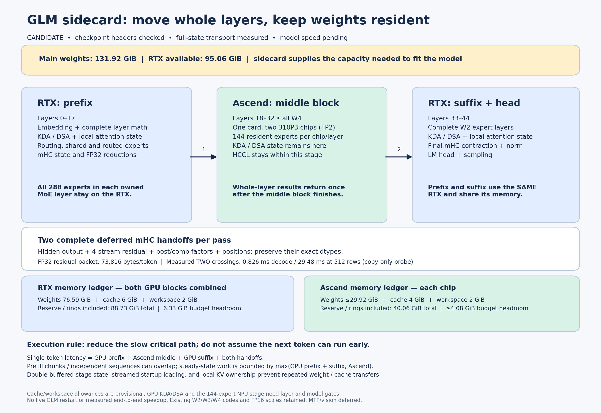

# Capacity-first GLM sidecard: complete layers on each architecture

The RTX wins the measured math paths, but the main-model checkpoint contains
**131.92 GiB of weights**, while the RTX has **95.06 GiB available**. Ascend's
resident memory makes this a feasible model placement problem. The design should
spend that capacity while removing avoidable slow work and cross-device joins
from the single-token critical path.

The proposed first implementation is a **CUDA prefix → Ascend middle → CUDA
suffix**, with complete layers and their attention state resident on their owner.
The prefix and suffix share one RTX; the middle uses both chips on one Ascend
card. It replaces the old 42 CUDA expert rendezvous per model pass with two
whole-layer architecture boundaries. GLM remains stopped. This is a concrete
architecture candidate with a checked storage ledger and a measured transport
prototype, not a running replacement or a measured end-to-end speedup.



Download the [PNG](architecture.png) or [SVG](architecture.svg). The figure is
generated from [design.json](design.json) and the [hardware transport receipt](stage-transport.json),
so memory and measured transfer labels are reproducible.

## Placement and memory

| Stage | Device | Layers, zero based | Complete work owned |
| --- | --- | --- | --- |
| Prefix | RTX | 0–17 | Embedding, attention, mHC, routing, shared/routed experts |
| Middle | Ascend card 16409, physical 2/3 | 18–32 | Complete W4 layers; TP2 within the stage |
| Suffix | Same RTX | 33–44 | Complete W2 layers, final mHC/norm, head, sampling |

All 288 experts in a GPU-owned MoE layer are resident on CUDA. Each Ascend chip
holds 144 experts per middle-block layer. Expert codes retain their checkpoint
W2/W3/W4 widths and original FP16 scales; lossless compact CUDA packing changes
layout, not trained values. Dense weights are FP16 in the inspected export.
The initial scope is main-model text inference; layer-45 MTP and vision are
outside the first implementation/qualification target.

The inventory reads safetensors headers and validates tensor byte ranges, shapes,
and index coverage. The [header gate](header-gate.json) checked all 75,575 tensor
descriptors. Its metadata and header hashes are preserved. It does not
reread or authenticate all weight payloads. Every routed layer has all six
code/scale tensors for each expert, and its aggregate size matches the canonical
GLM geometry. Full payload authentication remains a loader admission gate.

| Budget, GiB | RTX, both blocks combined | Ascend chip 2 | Ascend chip 3 |
| --- | ---: | ---: | ---: |
| Available after existing driver allocation | 95.06 | 44.78 | 44.15 |
| Main-model weight payload | 76.59 | 29.92 | 29.92 |
| Proposed cache allowance | 6.00 | 4.00 | 4.00 |
| Proposed runtime workspace | 2.00 | 2.00 | 2.00 |
| Explicit reserve | 4.00 | 4.00 | 4.00 |
| Double-buffered input/output stage state | 0.14 | 0.14 | 0.14 |
| Budgeted peak | 88.73 | 40.06 | 40.06 |
| Budget headroom | 6.33 | 4.71 | 4.08 |

The NPU payload bound conservatively replicates **all dense middle-block weights
on both chips** and shards only the expert banks. Actual TP sharding may use less.
The provisioned startup scratch is 3 GiB on CUDA and 2 GiB per NPU, with cache
allocation deferred until weight preparation finishes. Peak accounting uses
`weights + max(startup, cache + runtime workspace + rings) + reserve`, rather
than charging disjoint lifetimes simultaneously.

These are explicit allowances, not hardware-qualified whole-model allocations.
The loader must select owned layers before allocating, stream one layer's native
bytes into final compact/grouped banks, and release conversion aliases as it
goes. Loading the full model and freeing unwanted layers afterward would defeat
the capacity plan. Actual operator preparation and cache accounting must pass
their own memory gates on the smaller chip.

The planner also enumerates feasible contiguous intervals. It ranks capacity
alternatives by NPU layer count and headroom; this is not a measured latency
ranking. Layers 18–32 form the complete middle W4 run with useful headroom. A
shorter interval leaves less memory for CUDA cache/workspace. The choice should
be revised if actual layer timing favors another feasible block.

## The boundary carries deferred mHC state

GLM's existing model defers an FFN mHC post operation into the next layer's fused
post/pre. Passing just a hidden vector would drop that pending computation.
The stage data plane preserves the whole tuple:

| Field | Shape per T rows | Wire dtype |
| --- | --- | --- |
| Hidden output | T × 4096 | FP16 |
| Residual accumulator | T × 4 × 4096 | FP32 conservatively; FP16 only for a qualified state policy |
| Post factors | T × 4 × 1 | FP32 |
| Combination factors | T × 4 × 4 | FP32 |
| Positions | T | INT64 |

With FP32 residuals, this is **73,816 bytes/token**, or **37,793,792 bytes for 512
rows**, before the small frame header. The next stage consumes the deferred
tuple exactly once. The final contraction happens only at the final main-model
layer on CUDA. No layer boundary introduces an FP32-to-FP16 residual conversion.
The probe includes FP32 residual values beyond FP16's finite range to catch such
an accidental conversion.

The prototype protocol checks checkpoint identity, sequence, field coverage,
dtypes, canonical byte ranges, and bounded frame sizes. It transfers into
preallocated pinned buffers. Production admission/control still needs request
and stage identity, cache/page mapping, cancellation, error propagation, and
batched sequence metadata. This data-plane prototype is not a serving endpoint.

## Hardware-qualified transport

One CPU/CUDA process and one separate torch_npu process executed the complete
pinned CUDA → host → Ascend → host → CUDA round trip on physical NPU 2. This is
the two architecture boundaries around the middle stage, with the NPU compute
temporarily replaced by an identity copy. Each sample ends only after the
suffix-side CUDA upload completes. Verification downloads that CUDA result
outside the timer and compares every byte.

| Rows | FP16 residual, both boundaries ms | FP32 residual, both boundaries ms |
| --- | ---: | ---: |
| 1 | 0.880 | 0.826 |
| 4 | 0.978 | 1.014 |
| 128 | 5.568 | 8.316 |
| 512 | 17.869 | 29.481 |

All eight cases passed full bitwise checks with two distinct input patterns,
including signed zeros and positions. Three warmups and 15 samples per case are
retained. The small FP16/FP32 ordering is within host-dispatch effects; these
results do not establish a useful small-packet advantage for either state dtype.
The measured time includes four device copies, socket framing/transfer, host
submission, and synchronization. It excludes the Ascend TP broadcast/reduction,
all model math, and the production scheduler. The stage transfer result therefore
does not qualify layer correctness or predict full-model tokens/s. Fixtures are
packed before timing; packing live model tensors into these buffers and rebinding
them on receipt remain implementation costs to measure.

Executed sources and their hashes are preserved under [executed-source](executed-source/).
The current planner adds stricter inventory-geometry validation afterward; the
wire geometry and transport paths retain their measured definitions. The other
physical card's Qwen workers were not signaled or reset; the [after snapshot](hardware-after.json)
confirms their original PIDs and the idle RTX/assigned card.

## Why this can improve the critical path

The previous precision-resident service kept attention, mHC, shared experts and
the backbone on Ascend in all 45 layers. Moving more routed experts to CUDA left
that slow chain in place, so V19 improved observed decode only from 3.6687 to
3.7942 tokens/s and regressed cold first-text latency. The proposed split moves
**30 complete backbone layers** to the RTX and confines NPU TP coordination to
the 15-layer middle block. It also removes repeated expert-output integration
across architectures from every routed layer.

There is a real countervailing cost: the Ascend middle now computes **every
selected expert** in its 15 layers. V19 computed only 112/288 W4 experts across
both NPU chips in each of 22 layers. Under a uniform-routing workload, expected
NPU expert routes rise from `22 × 8 × 112/288 = 68.44` to `15 × 8 = 120` per
token, about **1.75×**. Real routing may differ. Removing backbone and integration
latency must outweigh that extra expert work; memory feasibility alone cannot
prove a speedup.

For one autoregressive sequence, the dependency chain remains:

```text
T_token = T_CUDA_prefix + T_NPU_middle + T_CUDA_suffix + T_two_boundaries
          + production scheduling / TP / control costs
```

The measured V19 decode rate corresponds to about **263.56 ms/token**. A 2×
target requires the new complete chain below **131.78 ms/token**, not merely a
fast CUDA MoE microkernel. The 0.826 ms copy-only boundary result leaves about
130.95 ms for compute and the control/TP costs it excluded. This is a break-even
target to measure, not a forecast or an achieved speed claim.

Prefill chunks and independent sequences can overlap. While Ascend processes
chunk A's middle, RTX can run chunk B's prefix, provided caches and workspaces
are correctly isolated. Suffix work should have priority when A returns.
Prefix and suffix consume the **same GPU**, so an optimistic steady-state bound
is `max(T_CUDA_prefix + T_CUDA_suffix, T_NPU_middle)`, with additional effects
from transfers, startup/drain, resource contention and scheduling. The next
autoregressive token cannot enter its prefix before the prior token is sampled.

KV, KDA recurrent state, convolution state, and DSA/indexer pages remain on the
device that owns the layer. They are not copied at each boundary. Context capacity
must be admitted independently on each device and verified with completed prefill
and generation; the cache allowances above do not establish a token limit. Prefix
reuse must be agreed across all stage-local cache owners.

## Implementation and promotion gates

1. Create an isolated CUDA model runtime; the current benchmark interpreter has
   CPU PyTorch and calls standalone CUDA libraries. Port/qualify GPU KDA, DSA with
   its indexer, mHC, and the checkpoint loader with unchanged trained codes/scales.
2. Build one CUDA actor owning both GPU blocks, and one Ascend TP2 actor owning
   only layers 18–32. This is a heterogeneous coordinator, not a homogeneous
   `--pipeline-parallel-size 3` launcher flag. Admit real weight and scratch bytes
   before loading any unowned tensors.
3. Qualify complete W4 middle-layer ownership: 144 native experts per chip,
   eight routes/token, balanced and skewed routes, decode and realistic prefill.
   Measure the actual two-chip critical path; the old two-route microbenchmarks
   do not supply that number.
4. Shadow complete layers and both boundaries, including deferred mHC, router
   selections, KDA/DSA state, shared experts and TP composition. Retain the dtype
   policy and validate any arithmetic differences separately. CPU byte fidelity
   alone cannot qualify those computations.
5. Add bounded asynchronous stage rings with ownership fences and cancellation.
   First qualify serialized execution, then compare overlapped execution against
   it on real inputs. Do not overwrite a stage packet still in flight.
6. Complete paired cold-prefill and fixed-output decode trials with identical
   tokens/checkpoint, recorded prefix reuse, first-text latency, memory peaks,
   repeat spread, and model-quality gates. Earlier greedy-repeat variation is
   unresolved and needs independent attention. Promote only a measured overall
   improvement; retain rollback.

## Reproduce

```bash
python -m tools.sidecard.layer_block_design \
  --checkpoint /path/to/native-checkpoint --output /tmp/design-new.json
python -m tools.sidecard.layer_block_design \
  --inventory artifacts/sidecard-layer-block-design-20261011/checkpoint-inventory.json \
  --output /tmp/design-offline.json
ASCEND_RT_VISIBLE_DEVICES=2,3 python -m tools.sidecard.stage_probe \
  --checkpoint-sha256 PINNED_NATIVE_MANIFEST_SHA \
  --npu-python /path/to/qualified/npu/python \
  --cuda-runtime /usr/local/cuda/lib64/libcudart.so \
  --output /tmp/stage-transport-new.json
python -m tools.sidecard.draw_layer_block_design \
  --design artifacts/sidecard-layer-block-design-20261011/design.json \
  --probe artifacts/sidecard-layer-block-design-20261011/stage-transport.json \
  --output /tmp/sidecard-design.png
```

The NPU environment needs the qualified CANN paths and libraries. The probe
guards visibility to physical 2,3 and uses logical 0, physical 2; it does not
start or stop services. The [executed command](stage-command.json) records the
host paths and argv. The design tool makes no accelerator allocations.

Offline verification covers per-device overcommit, startup/runtime lifetimes,
full state fields and dtypes, changed patterns, FP32 residuals beyond FP16 range,
socket identity/sequence/bounds, and incomplete inventory rejection.
Hardware qualification is limited to the transport described above. Whole-model
weights, workspace, context capacity, stage math, overlap and speed remain
unqualified for this candidate.

The complete sidecard CPU suite passed **452 tests**, including **18 new tests**
for this design. Changed-file lint and formatting passed. Repository-wide checks
retain their existing unrelated baseline failures; the isolated run receipt is
preserved with the design.
