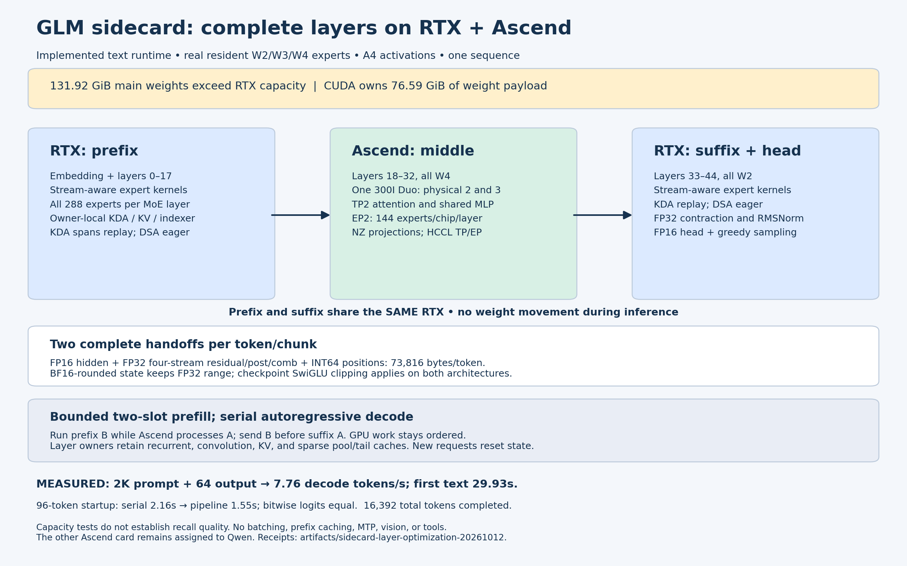

# GLM sidecard optimization: prepared weights and CUDA replay

The real 45-layer text service measured **7.7603 decode tokens/s** on the
completed 2,048-token prompt and 64-token output fixture, versus **5.1488**
before this optimization: **50.7% higher decode throughput**. Three completed
short-prompt runs measured **9.0691–9.0855 tokens/s** internally.

The [verified live deployment](deployment-receipt.json) serves
`http://192.168.53.187:8000/v1`, model `glm-sidecard`.
It uses one RTX PRO 6000 Blackwell and one Atlas 300I Duo, physical NPUs 2
and 3. The other card's Qwen workers remain assigned to physical NPUs 0 and 1.
All 288 experts remain available per routed layer. No checkpoint or
quantization policy change was used to obtain the improvement.



## Promoted changes

- Ascend linear projection weights are converted to FRACTAL_NZ once, after
  merging/sharding, avoiding repeated skinny-GEMM weight conversion. DSA's
  absorbed KV and indexer operands retain their existing layouts.
- CUDA expert copies, projections and weighted reduction execute on the
  current Torch stream. The new authenticated C ABI preserves the legacy
  entry points and eliminates per-layer device synchronization.
- CUDA captures nine contiguous KDA spans: prefix starts 0/4/8/12/16,
  suffix starts 33/36/40/44. Replay preserves recurrent/convolution state and
  copies every deferred mHC input. DSA cache control, multi-token prefill,
  and vocabulary head execution stay eager.

Ascend KDA-span capture was tested but is disabled in the promoted
specification: its matched result did not improve on prepared weights alone.
Layer ownership, two complete architecture handoffs, bounded two-slot
prefill, clipped routed activations, and serialized requests are unchanged.

## Completed hardware measurements

Every row below uses the same local checkpoint, exact 2K/64 fixture, greedy
generation with EOS ignored, and zero reused prefix tokens. Decode excludes
prefill. These are service measurements, not raw-math estimates.

| Configuration | Decode tokens/s | First text, seconds | Total, seconds |
| --- | ---: | ---: | ---: |
| Prior V13 | 5.1488 | 30.1047 | 42.3405 |
| V14: prepared Ascend projections | 6.0993 | 29.9982 | 40.3273 |
| V15: projections + Ascend KDA replay | 6.0698 | 29.8344 | 40.2136 |
| Promoted V18: projections + CUDA streams/replay | 7.7603 | 29.9304 | 38.0486 |

Receipts: [prior baseline](../sidecard-layer-runtime-20261012/api-gate-v13-decode2048.json),
[layout-only run](layout-decode2048.json), [Ascend replay gate](npu-graph-api-gate.json),
and [promoted client benchmark](api-gate-decode2048.json).
A [second completed matched run](decode2048-confirmation.json) measured
**7.8325 tokens/s** after the idle gate. The promoted result combines CUDA
stream execution and CUDA replay; it is
not an ablation isolating those two changes.

The [generation summaries](generation-summary.json) retain three 10/64
internal measurements. The [second matched run's internal metrics](matched-generation.json) had
median decode stage times of 13.24 ms CUDA prefix,
101.23 ms Ascend middle roundtrip, and 11.79 ms CUDA suffix.
Ascend remains the dominant decode cost. Cold prefill is still slow: about
30 seconds for the 2K fixture and 196 seconds for 16K. CUDA replay applies
to one-token steps and does not eliminate the sequential Ascend recurrence
inside multi-token prefill.

| Latest prompt tokens | Output tokens | Client first text, seconds | Client decode tokens/s |
| ---: | ---: | ---: | ---: |
| 4,096 | 8 | 51.3562 | 7.8659 |
| 16,384 | 8 | 196.1794 | 7.7436 |

The [latest capacity regressions](context-gate.json) completed generation
with exact usage at both lengths. The configured cap remains **65,536 total
tokens**. The earlier runtime completed [65,504 + 32](../sidecard-layer-runtime-20261012/context-gate.json);
that full-capacity test was not repeated for this optimization. Capacity and
five arithmetic prompts do not establish general model accuracy or long-context
recall quality. No 128K, 1M, batching, MTP, vision, or tools result is claimed.

## Numerical and operational validation

The [numerical identity check](numerical-identity.json) passed three
teacher-forced 64-token trials: complete prefix and middle handoff bodies
and full vocabulary logits have identical hashes across V13, V14 and V18.
This is a tested fixture, not a claim of bitwise equivalence for every prompt.
The promoted 2K/64 output text also matches V13 exactly.

- [Ascend projection profile](projection-summary.json): all 24 measured
  layout comparisons were bitwise equal. For layer 18 decode, merged input
  projection fell from 1.861 to 0.605 ms and output projection from 0.798
  to 0.243 ms. The [raw receipt](projection-profile-rank0.json.gz) also
  records isolated mHC, routing, attention and shared MLP costs.
- [CUDA stream expert gate](cuda-stream-expert-gate.json): 18 real W2/W3/W4
  cases on nondefault streams passed the independent CPU reference,
  clipping and repeat checks.
- [TP2 rank 0](tp-rank0-gate.json) and [rank 1](tp-rank1-gate.json): 24 real
  attention/shared-MLP cases each passed complete CPU references.
- [Pipeline parity](pipeline-parity.json): complete vocabulary logits were
  bitwise equal between serial and two-slot prefill on the 96-token fixture.
- [API gate](api-gate.json): arithmetic 5/5, three equal repeated completions,
  4K/16K generation, and invalid-request rejection passed.

The [operational gate](operational-gate.json) passed queued-request isolation,
streamed reasoning/content/usage, cancellation followed by another request,
a single synthetic needle, and real generation after **315 seconds idle**.
The needle is one smoke case and does not establish general retrieval quality.

The [checkpoint audit](checkpoint-cache-audit.json) checked all 362 manifest
shards before the final restart. One cached native shard initially differed;
targeted cache invalidation and a cold read restored the original checksum
with unchanged file metadata. No checkpoint file was written and no checksum
gate was bypassed. The loader retains private staging and authentication.

Portable validation: **542 tests passed** with
`pytest --noconftest -q tests/ut/sidecard`. Scoped manual hooks passed.
The [lint summary](lint-summary.json) and [full CI log](format-ci.log.gz)
retain seven existing repository-wide failure categories. The full formatter
ran in an isolated worktree; 144 unrelated edits were restored there and
no scoped file was modified by that check.

## Reproduction

Use the [runtime specification](runtime-specification.json) with the
[launcher/runbook](../../tools/sidecard/LAYER_RUNTIME.md). The deployed source
hashes are [retained](executed-source-sha256.json). The [source parity receipt](source-parity.json) confirms all executed model
and transport sources match this checkout. Later profiler field names,
diagram labels, and an immutable kernel-name set affect utilities only.
Both graph flags are explicit: CUDA enabled, Ascend disabled.

The [CUDA build receipt](cuda-stream-build.json) records its exact SM120
compiler command with `--fmad=false`, source hashes and library checksum.
The [frozen clipped sources](cuda-stream-sources.tar.gz) reproduce that binary.
The [joined kernel receipt](joined-kernel-build.json) binds it to the unchanged,
authenticated clipped Ascend kernels. `tools.sidecard.layer_cuda_join`
recreates that binding; build receipts alone do not claim hardware validation.

```bash
python -m tools.sidecard.layer_runtime \
  --specification artifacts/sidecard-layer-optimization-20261012/runtime-specification.json \
  --cuda-python /srv/ai/venvs/sidecard-cuda-20261012/bin/python \
  --output /srv/ai/storage/artifacts/sidecard-layer-optimized-new \
  --port 8000
```

Choose a new output directory and free loopback HCCL rendezvous port. Preserve
physical NPU visibility `2,3`; stop only the exact recorded service parent.
