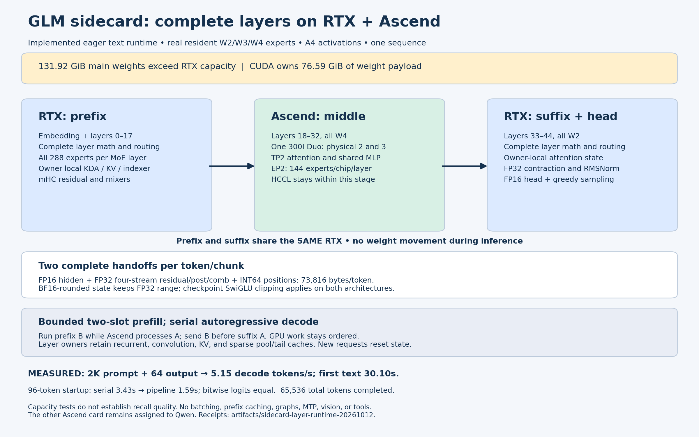

# Complete-layer GLM sidecard: implementation and hardware qualification

The complete 45-layer text model runs on one RTX PRO 6000 Blackwell and one
Atlas 300I Duo card, using only physical NPU devices 2 and 3. CUDA owns
embedding, layers 0–17, layers 33–44, final normalization/head, and greedy
sampling. The Ascend middle block uses TP2 attention/shared MLP and EP2 routed
experts, retaining 144 experts per chip and all 288 experts per MoE layer.
The other Ascend card and its Qwen workers are preserved.

The [operational gate](operational-gate.json) passed queued-request isolation,
streamed reasoning/content and usage, client cancellation followed by generation,
and generation after **315 seconds of idle time**. A single 4K-plus synthetic
needle was recalled correctly; that one probe is not general retrieval coverage.

The service endpoint is `http://192.168.53.187:8000/v1`, model `glm-sidecard`.
Use the [runbook](../../tools/sidecard/LAYER_RUNTIME.md) and
[tutorial](../../docs/source/tutorials/models/GLM5.3-Flash-Sidecard.md).
This is an experimental eager text runtime, independent of vLLM's scheduler.

## Completed performance measurements

The live v13 service measured **5.1488 decode tokens/s** on the completed
2K/64 fixture, with first text in **30.1047 seconds** and total time
**42.3405 seconds**. Three short-prompt 64-token runs measured
**5.7081–5.7317 tokens/s**. The [live API gate](api-gate-v13.json) and
[live decode receipt](api-gate-v13-decode2048.json) retain those results.
Compared with historical V19, the matching client benchmark improves decode
throughput by about **36%** and first-text latency by about **25%**.

The complete-model v12 run used real checkpoint weights; no dummy model or
microbenchmark estimate substitutes for the API measurements. The matching
historical reference uses the same 2,048-token prompt and 64-token output
fixture with EOS ignored, zero reused prefix tokens, and the same checkpoint.

| Measurement | Historical V19 expert-dispatch service | Complete-layer runtime v12 |
| --- | ---: | ---: |
| 2K/64 decode tokens/s, client measurement | 3.7942 | 4.8537 |
| 2K/64 time to first text, seconds | 39.9739 | 30.0823 |
| 2K/64 total request time, seconds | See reference receipt | 43.0622 |
| Short-prompt 64-token decode, three completed runs | Different fixture | 5.7016–5.7419 |

The matched service comparison improves decode throughput by approximately
28% and first-text latency by approximately 25%. It is not a controlled
placement-only ablation: the new runtime also fixes clipping, changes
residual storage/rounding, shards the middle block, and enforces deterministic
backends. The earlier 5.94–5.98-token/s candidates omitted routed clipping or
failed the final repeat gate; they are not the promoted configuration.

Receipts: [new completed 2K/64 test](api-gate-decode2048.json),
[request summaries](generation-summary.json), and
[historical V19 test](../sidecard-glm-20261011/precision/decode64.json).
Decode excludes prompt processing and counts completed output tokens.

| Cold prompt tokens | Output tokens | Internal first-token time, seconds | Decode tokens/s |
| ---: | ---: | ---: | ---: |
| 4,096 | 8 | 57.8837 | 5.2404 |
| 8,192 | 8 | 110.4052 | 5.1934 |
| 16,384 | 8 | 213.4644 | 5.1662 |
| 65,504 | 32 | 846.8967 | 5.0633 |

The [capacity receipt](context-gate.json) records completed generation and
exact token usage at every length. **65,504 + 32 = 65,536 total tokens
completed.** The 64K prompt took about 14.1 minutes before its first token;
long-prefill latency remains substantial. These repetitive fixtures establish
capacity, latency, and finite generation, not long-context recall quality.
The model config allows 1,048,576 positions; the deployed total cap is 65,536.
No 1M or 128K/16-sequence completion is claimed.

The [96-token pipeline gate](pipeline-parity-v13.json) compares serial and
bounded two-slot prefill using complete logits, including the vocabulary head.
Both outputs are bitwise equal. Its timing is a startup measurement, not an
independently warmed prefill ablation. CUDA prefix and suffix share one GPU;
only known prompt chunks overlap with Ascend. Autoregressive decode is serial.

At 16K context, seven decoded steps had median stage times of 34.87 ms CUDA
prefix, 131.25 ms middle roundtrip including transport/TP/EP, and 25.53 ms CUDA
suffix. The eager middle block remains the main decode bottleneck. Summing
these serial decode times is meaningful; overlapped prefill roundtrip times
include CUDA work and must not be summed for a wall-time estimate.

## Numerical and functional qualification

The checkpoint manifest SHA256 is
`a40e4312e4cd4162e7947aeb28c6fb80484a7500dc617f226eada1ed274d6a9f`.
Main weight payload is 131.9204 GiB; CUDA-owned weight payload is 76.5866 GiB.
The GPU load receipt showed 69,249,221,632 bytes in compact expert banks,
13,762,059,776 bytes in Torch allocations, and 18,210,881,536 free bytes after
releasing temporary preparation allocations. The old design's replicated
NPU dense-weight estimate is superseded by actual TP2 shards.

Expert W2/W3/W4 codes, A4 quantization, and permanent FP16 scales are
preserved. Dense projections use FP16; routing, weighted reductions,
recurrent state, and residual accumulation use FP32. Residual/mixer values
round to BF16 precision in FP32 storage. Final contraction and RMSNorm remain
FP32 until normalized head input converts to FP16. Both architectures apply
GLM's configured asymmetric SwiGLU clipping: gate at most 10 and up in
[-10, 10]. Both Torch backends enforce deterministic algorithms; CUDA also
disables reduced-precision GEMM reduction and uses its deterministic cuBLAS
workspace configuration.

| Gate | Coverage and result |
| --- | --- |
| Dense/KDA/DSA component arithmetic | 14 CUDA cases; 12 cases on each NPU; real weights versus CPU references |
| Clipped routed expert arithmetic | 18 CUDA cases across W4/W3/W2; 12 W4 cases on each NPU; changed inputs, 1/4/17 rows, zero-weight route |
| Sparse indexer | Six cases on each of CUDA/NPU0/NPU1 beyond 2K; exact selected-token sets and causality versus independent pooled CPU operators |
| Middle TP2 | 24 cases per rank; real layer 18 KDA, layer 19 DSA, shared MLP versus summed complete CPU references |
| Native expert startup repeat | All 15 middle layers, all routes on either rank, four bitwise repeated reductions per case |
| Complete decode repeat | Three 64-token teacher-forced passes; every complete prefix/middle handoff and full logits hash equal |
| Complete prefill pipeline | Serial/pipeline complete vocabulary logits bitwise equal |
| API arithmetic smoke | Five of five exact answers; zero-shot elementary arithmetic only |
| Context capacity | Completed total budget of 65,536 tokens, including 32 output tokens |

The [component receipts](components/) include exact per-element tolerances,
errors, shapes, and clipping-activated counts. CUDA routed results matched
its independent CPU reference exactly; the first NPU routed gate's maximum
absolute error was 0.000136. Dense/TP2 gates permit 2.5% relative plus 0.02
absolute error; routed gates permit 0.2% plus 0.002. Those tolerance scopes do
not imply equivalence to the original unquantized model.

The [full decode traces](decode-repeat-gate-v13.json),
[startup generation](startup-inference-v13.json), and
[API gate](api-gate-v13.json) use all 45 real-weight main layers. The
[custom accuracy configuration](../../tests/e2e/models/configs/GLM5.3-Flash-Sidecard.yaml)
is consumed by `tools.sidecard.layer_validate`, not the standard lm-eval
harness. No general benchmark accuracy score is inferred from five arithmetic
prompts.

## Startup and lifecycle corrections

Raw 310P HCCL Broadcast returned unchanged receivers. Startup now verifies
byte AllGather and FP32 SUM; HCCL communicator bootstrap happens before
weights load. GPU and NPU environments remain separate. No cross-vendor
HCCL/NCCL tensor-parallel group is created.

Idle control moved to private CPU sockets after an earlier worker timed out
at 300 seconds. NPU actors install a Linux parent-death signal. SIGTERM
interrupts prefill between chunks, and cleanup targets only recorded owned
processes. A streaming client disconnect exposed a suspended generator that
retained the request lock. The final API wrapper explicitly closes its async
and synchronous generators; cancellation cleanup does not depend on garbage
collection.

A cached native-shard read failed authentication. Invalidating only that
file's page cache restored the expected hash; its on-disk bytes and the local
original were already correct. No checkpoint payload or manifest was rewritten.
See the [audit](checkpoint-cache-audit.json). NPU staging now reads into
private anonymous buffers, avoids exposing mapped checkpoint pages to CANN,
and authenticates again after loading. The cache observation alone does not
identify a definitive hardware or software cause.

Passing isolated expert repeats was insufficient: a later complete-model
repeat diverged. The final deterministic configuration passed complete
boundary/logit traces and API repeats. The reused expert kernels also lacked
GLM clipping; an authenticated source patch rebuilt only generic/W4 native
gate stages and the compact CUDA library. Pack/down/reduction binaries and
the frozen checkpoint bundle remain unchanged.

## Reproduction and remaining scope

The [runtime specification](runtime-specification.json) references host-local
checkpoint, interpreter, native library, and environment paths. The private
NPU environment itself is not published. The [CUDA environment](cuda-environment.json)
contains only the deterministic workspace setting. The
[clipped kernel build](clipped-kernel-build.json),
[original provenance](original-native-provenance.json), and
[frozen source archive](frozen-native-sources.tar.gz) reproduce the clipping
change without consuming unrelated workspace experiments.

The 64K capacity request ran on v12. The final v13 server changes HTTP stream
cleanup; its model/transport/kernel execution files and generation/admission
logic are unchanged. The [source-identity receipt](capacity-math-source-identity.json) records those comparisons;
final API, cancellation, performance, and idle-recovery gates run on v13.
This distinction preserves the exact scope of each hardware result.

ACLGraph/CUDA graphs, flashcomm1, MTP, vision, tool calls, batched scheduling,
and prefix caching are not implemented in this independent runtime. They
are not advertised as successfully validated plugin features. New work should
focus on native middle-block KDA/mHC execution and faster grouped CUDA expert
kernels; raw matrix peak rates do not predict this batch-one routed workload.

**529 portable CPU tests passed**, along with all scoped pre-commit hooks.
The portable CPU suite uses `pytest --noconftest -q tests/ut/sidecard` because
normal checkout conftest imports an unavailable upstream vLLM attention module.
Changed-file hooks are run separately. Repository-wide `bash format.sh ci`
has seven existing failing hook categories; its unrelated formatter edits
were confined to an isolated worktree and restored. See the
[lint receipt](lint-summary.json) and [full compressed log](format-ci.log.gz).
