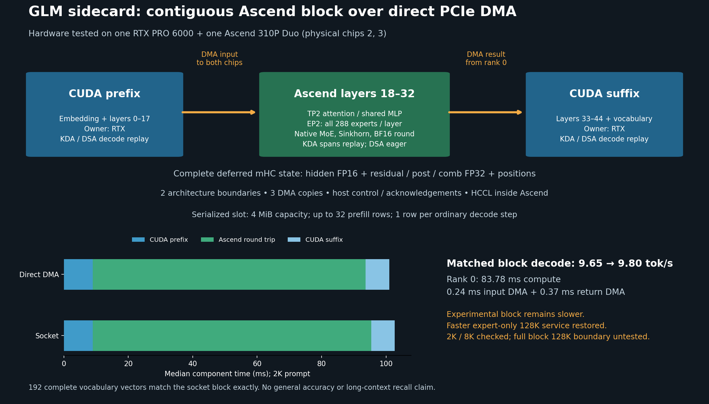

# GLM Sidecard Execution and Prefill Performance PRD

- **Status:** Draft for implementation, October 13, 2026
- **Product:** GLM-5.3-Flash serving on one RTX PRO 6000 and one Ascend Duo
- **Hardware allocation:** RTX plus physical Ascend chips 2 and 3; chips 0 and 1 remain available for unrelated work
- **Deployment baseline:** CUDA backbone with Ascend cold experts, direct PCIe DMA, 131,072 total tokens
- **Experimental architecture:** CUDA prefix, complete Ascend layers 18–32, CUDA suffix

## Product outcome

Make single-request GLM inference faster while keeping the model resident across
one RTX and one Ascend card. Improve both sustained decode and cold prefill for
the full coding workload without shortening prompts, removing tools, changing
the checkpoint, or reducing the qualified context capacity.

The complete Ascend block reduces cross-architecture boundaries to two, but
its current execution is slower than the deployed cold-expert design. Optimize
its kernels, scheduling, and packing, then choose the architecture using matched
serving measurements. Retain the faster qualified service until a candidate
passes performance, correctness, context, and ownership gates.

This PRD complements the earlier
[four-chip Ascend performance plan](glm53_flash_310p_performance_prd.md).
Its hardware allocation and single-request targets apply to the RTX plus one
Ascend Duo configuration.

## Users and workloads

The primary user runs a local coding assistant through an OpenAI-compatible
endpoint and Kilo. A cold request must process the original conversation and
tool schemas quickly; subsequent generation must produce useful final content
and valid tool calls. A second user needs reproducible speed and architecture
claims for public technical reporting.

The performance fixtures are 2,048-token and 8,192-token prompts plus the
unchanged 23,820-token Code request with all 23 tools. Context qualification
uses the 131,072-token total admission boundary. Keep private prompts and
credentials out of public artifacts; record prompt identities and token counts
so local reproduction remains possible.

## Measured baseline

The following results were completed on October 13, 2026. The
[complete-block report](../../../../artifacts/sidecard-layer-dma-20261013/README.md)
contains configuration identities, raw receipts, and validation limits.

| Measurement | Completed result | Interpretation |
| --- | --- | --- |
| Deployed cold-expert API, restored 2K/64 request | 12.4416 decode tok/s; 9.9292 s to first text; zero reused prompt tokens | One restoration sample; establish a fresh repeated baseline before comparing candidates |
| Complete-block 2K/64 model forwards | Socket median 9.6470 tok/s; DMA median 9.8020 tok/s | Matched transport comparison, 1.61% decode improvement |
| Complete-block 8K/64 model forwards | Socket 9.5864 tok/s; DMA 9.7522 tok/s | One repetition per transport |
| Complete-block cold prefill | Socket 26.84–27.05 s at 2K and 100.31 s at 8K; DMA 30.27–30.56 s at 2K and 114.94 s at 8K | Socket overlaps two chunks; DMA has one serialized slot, so this is also a scheduling comparison |
| Rank 0 DMA decode medians | Input 0.2446 ms; execution/packing 83.7812 ms; return 0.3659 ms | The middle bucket includes model execution, packing, and device completion waiting; packing alone has not been isolated |
| Complete-block transport parity | 192 complete vocabulary vectors and output ID sequences match sockets exactly | Covers three 64-output fixtures at 2K/8K |
| Context capacity | Deployed architecture previously completed 131,008 prompt tokens plus 64 outputs | Complete-block capacity has only been exercised at 2K and 8K |

API decode and model-forward decode use different timing boundaries. They do
not establish a precise architecture speed ratio. The deployed projection
optimization also has a
[paired forward benchmark](../../../../artifacts/sidecard-projection-20261013/README.md):
12.525, 12.638, and 13.400 tok/s for 2K, 8K, and full Code respectively.
Those measurements exclude CPU vocabulary observation and snapshot restoration.

### Execution and communication

The deployed architecture keeps all 45 backbone layers, attention state, and
shared MLPs on CUDA. CUDA retains all experts outside layers 18–32 and 22 hot
experts per middle layer. Ascend holds resident cold expert banks. Its cold
prefill windows contain 1,024 rows while CUDA preserves 32-row arithmetic.
Logical 16 MiB slots use two bounded 8 MiB DMA regions.

The experimental block places embedding and layers 0–17 on CUDA, complete layers
18–32 on Ascend, and layers 33–44 plus head/sampling on CUDA. Attention and shared
MLPs use two-chip tensor parallelism; routed experts use two-chip expert
parallelism with 144 resident experts per chip. Two all-reduces per layer remain
inside Ascend, totaling 30 per decode token.

Both Ascend chips receive the complete deferred mHC state through DMA; rank 0
returns the block result. Two architecture boundaries require three DMA copies.
Each token carries 73,816 bytes: FP16 hidden state, FP32 residual and mixer
fields, and an int64 position. Dedicated 4 MiB slots currently admit one decode
row or up to 32 prompt rows. Host sockets carry metadata and acknowledgements,
and the host still launches kernels. Normal tensor payloads bypass host RAM.
This implementation is not a fully device-driven execution contract.

## Scope and constraints

Optimize the existing resident-weight checkpoint and direct-DMA transport.
Keep the current quantization map, clipping, tokenizer, chat template, and
routing semantics. Native kernels, graph capture, packing layouts, Ascend
collectives, and bounded prefill pipelining are in scope. Improvements that
also benefit the deployed cold-expert architecture should be evaluated there.

Prompt compaction, tool removal, extra accelerator cards, new quantization,
speculative decoding/MTP, and million-token serving are outside this pass.
Ordinary decode has one dependent next token per request. Larger prompt chunks
permit more prefill work per iteration; they do not make future generated
tokens independent. Context growth beyond 128K requires a separate capacity
and quality qualification.

## Proposed performance targets

Targets below are engineering acceptance criteria, not measured results.
Each comparison uses a contemporaneous qualified baseline with identical
checkpoint, prompt IDs, output budget, context reservation, hardware, and
measurement boundaries. Evaluate each workload separately rather than hiding
a regression inside an aggregate rate.

| Milestone | Acceptance criterion |
| --- | --- |
| Baseline and attribution | Repeat both architectures through the same API harness; identify execution, launch gaps, packing, collective arrival wait, collective transit, and DMA on the joined rank timeline |
| Useful decode candidate | At least 5% faster median API decode on its targeted fixtures, with no fixture worse by more than 3%; pass all applicable correctness gates |
| Decode release | At least 10% faster median API decode than the best qualified service at 2K, 8K, and full Code; cold time to first token may not regress by more than 3% |
| Prefill release | At least 20% lower median cold time to first token at 2K, 8K, and full Code; decode may not regress by more than 3% |
| Absolute decode objective | Reach at least 15 API decode tok/s on all three fixtures; retain relative release gates even if this objective is reached |
| Capacity and stability | Preserve 131,072 total tokens and full tools; complete the context and lifecycle gates on the exact release build |

An Ascend execution/packing bucket at or below 60 ms is an intermediate
checkpoint, requiring roughly 24 ms less than the observed 83.8 ms. It is not
a forecast of 15 tok/s. Fifteen forward tokens/s implies a 66.7 ms entire-step
budget before API overhead; the observed CUDA prefix and suffix already total
roughly 16.3 ms. An actual 15 API tok/s result therefore needs a larger block
reduction or additional overlap, established by measurement.

Use at least five paired repetitions per performance fixture, alternate
baseline/candidate order, and report spread and a confidence interval for the
paired change. Increase repetitions when noise prevents distinguishing the
target gain. A component improvement without a reproducible serving benefit
does not satisfy a release criterion.

## Functional and numerical requirements

| ID | Requirement | Acceptance evidence |
| --- | --- | --- |
| R1 | Preserve full request content and 128K total admission | Original prompt identity, 23-tool schema set, explicit input/output accounting, boundary request completion |
| R2 | Preserve checkpoint math | Packed-code decoding, clipping, route weights, correction bias, expert ownership, ordered combination, and state comparisons against the qualified reference |
| R3 | Preserve precision at state boundaries | FP32 recurrent state and preparation semantics; BF16-rounded residuals stored in FP32; residual values above FP16 range remain valid |
| R4 | Keep device memory ownership valid through asynchronous work | Both-chip completion, slot leases, graph-buffer lifetimes, mapping-release acknowledgements, failure and shutdown tests |
| R5 | Serve the coding client correctly | Chat and completion requests, streaming, finish reasons, reasoning/final content, and valid tool-call responses on the existing client profile |
| R6 | Preserve the unrelated hardware allocation | Experiments allocate only the RTX and Ascend chips 2/3; no card reset or global driver/clock/OPP change |
| R7 | Make release claims reproducible | Exact executed source/binary/configuration identities and receipts match the promoted server |

Transport, packing, and scheduling changes with unchanged arithmetic require
bitwise comparison of complete boundary state and complete vocabulary vectors,
plus output IDs. Kernel arithmetic changes must declare operator-specific
error limits before performance testing, compare real-weight model states and
logits, and pass task quality. Do not relax bounds after observing a failure.
Track router IDs and sparse-attention selections because small numerical
differences can change later execution paths.

The existing native KDA operator accepts FP32 carry state but requires FP16
normalized query/key and beta. The current sidecard preparation retains FP32
precision for those quantities. Its raw synthetic gate is finite but not
bitwise equal and has not qualified model accuracy. Adapt the input contract
before binding it. The existing mHC post kernel rounds/saturates to FP16 and
cannot replace the sidecard's BF16 rounding with FP32 range.

## Implementation priorities

### 1. Attribute the current critical path

Split the 83.8 ms bucket into layer/operator device execution, host launch gaps,
result packing, and the final completion wait. Trace both Ascend ranks and CUDA
with matched request, chunk, layer, and sequence identities. Separate time
waiting for the peer to reach an all-reduce from actual collective transfer.
Use device events or bounded sampled traces; avoid introducing a device
readback or synchronization at every operator.

Report the joined critical path and overlap, not the sum of independent median
durations. Older isolated layer profiles excluded expert-parallel collectives
and are useful hypotheses, not an attribution of today's full block. Measure
instrumentation overhead against an unprofiled run.

**Exit:** A reproducible current-build timeline, packing-only measurement,
rank imbalance analysis, and ranked achievable time savings. Freeze a fresh
API baseline and memory breakdown for both architectures.

### 2. Fuse KDA recurrence and mHC mixing

Implement a native KDA path that preserves FP32 normalization/beta and FP32
carry. Reuse existing projections and cache semantics; graph replay reduces
launches but does not fuse the recurrence. Check one-row decode first, then
chunked prefill with sequential carry preserved across chunk boundaries.

Fuse mHC pre/post operations to remove broadcast intermediates and short
launches. Preserve each rounding boundary and ordered residual combination.
Write outputs into persistent views where safe. Keep native Sinkhorn and the
already-qualified single-row BF16-rounding path as baselines. The BF16 rounding
operator was slower at 32 rows, so multi-row adoption needs its own timing gate.

**Exit:** Operator tests on both chips, large residuals and changed carry;
real-weight layer/state checks; declared numerical bounds; full-model quality
and measured serving improvement. Recurrent changes require long-context gates.

### 3. Cover multiple owned experts without decode padding

Build a one-token expert kernel covering zero through eight owned route
contributions, including repeated IDs and non-unit weights. Avoid the stable
17-row padded schedule while preserving packed W2/W3/W4 formats, clipping,
ownership, and fixed route reduction order. Use separate contribution storage
or a deterministic reduction rather than unordered floating-point atomics.

The earlier
[single-contribution graph](../../../../artifacts/sidecard-single-route-20261013/README.md)
passed numerical gates but covered only 7.2% of observed calls and failed its
performance gate. This package must cover the common multiple-contribution
case; repeating that disabled specialization is insufficient.

**Exit:** All-layer tests for zero, one, multiple, duplicate, and peer-owned
routes; representative measured route-frequency coverage; exact output checks
where arithmetic is unchanged; matched serving benefit without prefill loss.

### 4. Capture DSA and reduce internal synchronization

Four Ascend sparse-attention layers, 19, 23, 27, and 31, remain eager inside the
complete block. Capture their safe decode work using persistent buffers and
device positions while preserving causal selection, compressed pools,
incomplete tails, cache admission, reset, and prefix/suffix interfaces.

Use the profile to decide whether persistent/captured collectives or expert
ownership changes can reduce exposed waiting. A changed expert split requires
an explicit global-to-local expert map, unique complete ownership, and identity
checks; the existing contiguous 144-expert halves are the reference.

**Exit:** Dense/sparse threshold, all tail phases, changed positions, state
reset, and long-context tests; rank-arrival and collective-transit comparisons;
serving improvement without changed route or cache semantics.

### 5. Overlap shared MLP and experts and reduce result packing

Shared MLP and routed experts consume the same layer input and may run on
separate streams with independent workspaces and explicit completion events.
Measure Ascend core/DDR contention before keeping this overlap. The next layer
still waits for both contributions; adjacent dependent layers cannot run
independently.

Pack rank 0's final fields directly into the DMA result layout, or include the
packing operation in the final graph. Eliminate rank 1 result packing if its
result is never transferred, while preserving device completion before input
slot reuse and acknowledgement. Measure allocation, conversion, packing, and
wait separately; the current 83.8 ms bucket is not a packing estimate.

**Exit:** Changed-input and repeated-slot parity, both-rank lifecycle tests,
separate packing receipts, and a measured critical-path reduction. Introduce
additional streams or graph buffers only within the 128K memory budget.

### 6. Restore prefill overlap with two DMA slots

Add a bounded two-slot pipeline with per-slot request/sequence leases and
completion events. Overlap CUDA prefix for prompt chunk B with Ascend execution
of chunk A. Serialize conflicting work on the same RTX and preserve Ascend
carry/cache order between chunks. Return each result to its matching suffix
input, and retire all DMA and device consumers before reusing a slot.

Compare one and two slots under the same direct-DMA math and configuration to
isolate scheduling from transport. Evaluate native chunked KDA separately.
Retain the existing full Code prompt and measure cold runs with zero prefix
reuse. Larger slots alone are not a substitute for removing the row loop or
restoring overlap.

**Exit:** Partial chunks, cancellation, worker loss, stale completion,
shutdown, and slot-reuse tests; exact chunk/final state checks; peak memory
accounting; at least the proposed prefill release improvement.

## Benchmark and validation plan

Use isolated operator gates before expensive full-model reloads. For each
candidate, freeze source, native library hashes, checkpoint identity, device
mapping, runtime options, slot geometry, and memory reservation. The baseline
and candidate must share those properties except for the intended change.

| Test tier | Required cases and outputs |
| --- | --- |
| Portable unit tests | Dispatch and shape validation, arithmetic references, slot sequence/lifetime, capture fallback and cleanup, failure paths |
| Device operator tests | Both assigned chips, actual weights, changed inputs, 1/4/32 rows and supported tails, large FP32 residuals, repeatability |
| Complete-model parity | 2K, 8K, full Code; identical initial state and teacher tokens; complete vocabulary and recurrent/KV/pool/tail comparisons |
| API performance | At least five paired cold repetitions per fixture; at least 256 output tokens for sustained decode timing; record early EOS separately |
| Quality | At least 20 fixed arithmetic, instruction, coding, retrieval, and tool cases; completed final answers; valid reasoning/tool parsing and finish reasons |
| Context | 32K and 128K retrieval/state checks; actual 131,008-token prompt plus 64 outputs on the changed architecture/build |
| Stability and ownership | At least 100 mixed requests, repeated reset, prefix hit/miss where supported, cancelled/disconnected clients, worker failure, clean restart and mapping release |

Timed decode counts all generated tokens, including reasoning. Report API
inter-token rate using output token accounting and first/last emission times,
time to first emitted token, time to first visible text, total latency,
completion length, and finish reason. Do not substitute SSE chunk count for
token count. Keep model-forward timing separate and exclude diagnostic CPU
hashing from it. Quality requests use normal EOS and enough output budget to
finish; a forced-length timing fixture is not a task-quality test.

Cold prefill runs reset model state and have zero reused prefix tokens. Warm
prefix reuse is a separate workload. Complete-block prefix caching is not
currently implemented, so do not attribute the deployed cache's benefit to it.
Any new prefix path needs its own state and ownership qualification.

Record device and allocator peaks for weights, recurrent/KV/indexer state,
graph buffers, native workspaces, collectives, and DMA slots on each chip. A
two-slot or additional-graph design must fit while retaining full context.
Record faults, retransfers, queue time, and per-rank latency alongside speed.

## Delivery and promotion

Deliver each experiment as a scoped source change with tests and a dated
artifact containing baseline/candidate receipts, numerical comparisons,
performance distributions, timeline, memory accounting, and the keep/reject
decision. Update the design PNG when the executed architecture changes; its
labels must distinguish achieved timings from targets.

Run the applicable portable tests, device gates, changed-file lint, and
repository-wide formatting check. Identify unrelated existing failures
separately. Follow centralized environment configuration and signed-commit
requirements; keep kernel integration focused and reviewable.

Promote only the exact source and binaries used by the successful gates.
Require startup parity and a completed real request before declaring readiness.
Retain the prior configuration and validate restoration if an experiment
fails. Public speed claims must state the checkpoint, context, hardware,
prompt/output lengths, cold or cached status, and API or forward timing.

The first delivery is the current-build profile. Kernel work follows the
measured time-saving order, beginning with KDA/mHC unless profiling changes that
ranking. The contiguous block becomes the serving architecture only if it
beats the best qualified service. Otherwise, retain the useful expert and
packing improvements in the deployed cold-expert design and report the block's
measured limit.
